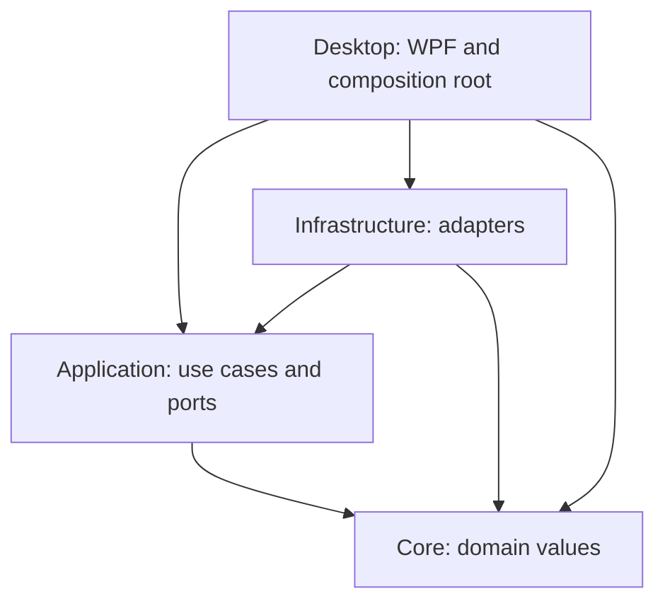

# Architecture

Status: Phase 2 desktop interactions complete as a development milestone at independent
QA 8.7/10; resource and physical qualification still block release. Configuration, log ports/adapters, instance
activation and WPF shell now exist. Phase 3 adds owned local model inference and
in-memory plain-text chat. Persistent conversation features, voice, memory, tools and
rich rendering below remain intended architecture. Review date: 2026-09-21; status synchronized 2026-09-22.

## Phase 1 implementation decisions

- Core owns immutable validated `CompanionSettings`. Application owns `ISettingsStore`
  and `IEventLog`; Infrastructure implements bounded versioned JSON and content-free
  JSONL logging. No provider/API dependencies are introduced.
- Persistence serializes validated in-memory last-known-good settings into the backup
  before atomic primary replacement. Corrupt primary data is atomically moved to one
  `.invalid` file, without copying unbounded input. Failed/unsupported loads cannot save.
  External valid edits require restart instead of silent overwrite.
- Log records accept enum event/area, operation UUID and optional duration only. Rotation
  bounds files/size; every actual write sweeps all channels by oldest-record age.
  A malformed first record or unterminated tail moves to one `.corrupt` file and surfaces a
  recovery notice. Retention may discard a whole file with newer records; it is a bound,
  not a promise to retain every recent event. No cleanup happens while the app is closed.
- Composition lives in Desktop. Runtime lifetime owns a cancellation source and serial
  save gate; async close drains work with a deadline. Postcommit diagnostic cancellation
  reports settings saved with a logging warning, never falsely reports rollback.
- Settings capture the requested preferences and native options when Save starts.
  Shutdown marks the settings window before disposing desktop integration, preventing
  a delayed save continuation from applying appearance, registering shortcuts, changing
  startup or re-enabling controls. A completed file commit remains committed even when
  shutdown suppresses the later UI effects.
- Single instance uses an exclusive profile/session file handle, released even on
  process death, plus a same-user named pipe carrying only a one-byte activation and
  acknowledgment. No commands, paths or free-form payload cross that IPC boundary.
- `--data-dir` selects an explicit absolute local test/development profile; UNC/device
  paths are rejected after normalization. Smoke modes exercise real composed services.
- MSTest is now a pinned test-only dependency. Runtime assemblies remain package-free.
  The dependency-free repository checks remain alongside standard test discovery/TRX.

## Technology decisions

Use C# on .NET 10 LTS, WPF, and narrowly wrapped Win32 calls. The inspected machine
has SDK 10.0.401 and WindowsDesktop runtime 10.0.12. Microsoft lists .NET 10 as active
LTS through November 2028 ([support policy](https://dotnet.microsoft.com/en-us/platform/support/policy)).
The first supported release target is Windows 11 x64; ARM64 is a later build/test
matrix extension. Target framework `net10.0-windows` is not a promise to support
every Windows version it can compile for.

WPF supports nonrectangular transparent windows with `AllowsTransparency` and
`WindowStyle=None` ([API documentation](https://learn.microsoft.com/en-us/dotnet/api/system.windows.window.allowstransparency?view=windowsdesktop-10.0)).
It also provides vector drawing, animation, binding, accessibility and Win32 interop.
Choose it over WinUI 3 for this initial overlay-focused product: mature window control
and fewer deployment dependencies outweigh adopting the newest visual framework.
This is an engineering tradeoff, not a measured performance superiority claim.
WinUI remains viable if a later prototype establishes a material accessibility or
rendering advantage. Avalonia adds a cross-platform objective not presently needed;
Electron/Tauri introduce a second UI runtime without solving the overlay's native
integration. WPF styling will use shared design tokens and native accessible controls.

Use a modular monolith initially, not microservices. No C++ is needed before profiling
identifies a hot path; a native library then exposes a versioned C ABI with explicit
ownership and SafeHandle wrappers, and is built with CMake plus sanitizer tests.
The user selected pretrained local inference after considering from-scratch training.
A pinned llama.cpp C++ worker supplies tensor inference outside the WPF UI; there is
no Python or training dependency in this path. The earlier Python experiment is
paused. See [the local AI decision](docs/LOCAL_AI.md).

Use SQLite via Microsoft.Data.Sqlite for structured state when storage is implemented,
with explicit SQL and migrations rather than an ORM at this scale. Use versioned JSON
for human-readable nonsecret preferences and manifests. Introduce pinned NuGet packages
only in their owning phase, with source/license/advisory review and lock files. The
baseline has no third-party packages; chat rendering, audio and scientific dependency
versions will be verified at implementation time rather than guessed now.

## Dependency structure

Core has no framework, filesystem, network, UI or database references. Application
owns ports and workflows. Infrastructure implements ports, including providers,
storage, voice, Windows integration, deterministic math and approved tool handlers.
Desktop binds view models, marshals updates onto its dispatcher and constructs the
services. Feature namespaces (Conversation, Memory, Tools, Voice, Avatar, Science,
Security, Storage) belong within these layers; split projects only when independent
deployment or dependency isolation warrants it. The test executable checks the
initial project graph. No service locator or global mutable permission state.

## Conversation, providers and logical agents

The flow is UI intent → primary assistant use case → bounded conversation engine →
selected provider → typed events → UI. The planner optionally turns a complex intent
into a versioned task plan (steps, dependencies, preconditions, status and cancellation).
The executor authorizes each tool operation separately. A model cannot approve its
own proposal. A runtime quality evaluator can check citations and call deterministic
validators; it is distinct from the mandatory independent **development QA agent**.

Provider-independent messages contain role, typed content parts, IDs, parent/branch
IDs and provenance. Stream events carry turn ID, sequence, text deltas, tool proposals,
usage, completion or typed failure. Adapters map provider protocols to these values.
No provider SDK types or raw chain-of-thought leak into UI/domain contracts. Capability
discovery declares vision, tools, reasoning controls, temperature and stream support.
Unsupported settings cause a visible validation error instead of silently changing
meaning. Store credential references separately from endpoint/model options.

The user selected a pretrained model running locally without an API key. Phase 3
begins with an owned llama.cpp CPU worker, bounded loopback streaming and in-memory
plain-text chat. History, branches, search and rich rendering remain subsequent
increments. There is no cloud fallback. The provider-independent port is an
architecture boundary, not a hosted-service requirement. Downloaded model weights
come from their original publisher; the user controls local inference and data.
This supersedes both the provider-first and briefly considered from-scratch plans.

Conversation streams use bounded channels, batched UI deltas (target 30–60 ms), one
active turn per conversation and a per-turn cancellation source. A global concurrency
limit prevents runaway provider calls. New/edit/regenerate forks conversation branches;
late events from older turns are discarded by ID. Preserve partial output with an
interrupted marker; never automatically replay a partially executed tool. Bound input
and output by tokens and bytes; provider-specific token counters are estimates unless
verified. Summarization cannot silently promote content to approved memory.

Chat uses a native WPF input/history shell and a lazily loaded WebView2 response view
for bundled Markdown, syntax highlighting and KaTeX. Separate it from the transparent
avatar window: WebView airspace and transparency are integration risks. Raw HTML is
disabled, output sanitized, remote assets/network navigation blocked, and no generic
host objects exposed. Links require explicit user activation and URI validation.
Use a narrow origin-checked copy/math-render message channel, with length/schema limits.
Follow [WebView2 security guidance](https://learn.microsoft.com/en-us/microsoft-edge/webview2/concepts/security).
No CDN scripts. Virtualize history; defer WebView disposal/suspension decisions to
measured hide/show behavior. Search, copy, stop, retry, titles, edit/resubmit, regenerate
and branch navigation receive UI and persistence tests in Phase 3.

## Avatar and desktop integration

Implemented `IAvatarRenderer` accepts semantic state and animation/high-contrast policy,
without conversation text or permissions. The default WPF vector control owns its
timelines and facial geometry; the host owns input, scale and placement. Eight states
are implemented: idle, listening, thinking, working, speaking, notifying, sleeping and
error. Scoped activity ownership prevents late completion from clearing newer work.
Sleep invalidates all visual leases; otherwise priority is error, listening, speaking,
working, thinking, notifying, idle. Future audio/conversation callers must cancel work
before entering sleep and derive speaking from actual playback. Current expression
previews are visibly labeled, last four seconds, and start no microphone or provider.
Idle uses one dispatcher timer: wait ten seconds, close the eyes for 120 milliseconds,
then reopen. Existing eye transforms change only at these transitions; idle owns no
WPF animation clocks. Active expressions use at most two capped 20-fps controllable
clocks, explicitly stopped, removed and detached on a state or motion-policy change.
Hide, sleep, reduced motion and unload stop the timer too; window close disposes the
renderer. The harness distinguishes enabled motion policy from completed timed blinks.
The ten-second cadence was selected before the next controlled run after the six-second
version measured 1.093335% visible-idle CPU against the unchanged exclusive 1% budget.
The closure duration and measurement method remain unchanged; earlier failures are retained.

Asset manifests declare schema version, ID, attribution/license, layers (body, face,
eyes, hair, clothing, accessories), palette, anchors, animation clips, frame bounds and
fallback states. Validate size, frame count, paths and decoded image dimensions. Never
load user XAML or scripts. A future 3D adapter consumes the same state model but will
have its own rendering surface/capability declaration; no 3D engine dependency now.

Native companion HWND: borderless/transparent, nonactivating when appropriate,
optional topmost and explicitly enabled click-through. Settings UI stays interactive.
Dragging uses device-independent coordinates converted at the monitor boundary;
persist monitor identity plus relative position, re-clamp on display/DPI/work-area
changes, including negative coordinates and disconnected screens. Edge snapping uses
work areas, not total monitor bounds. The per-monitor-v2 manifest is present, but
actual mixed-DPI behavior remains a pending Phase 2 validation matrix. Placement stores
device identity and fractions of available travel `(position-origin)/(work-size)`;
an oversized axis anchors to its work-area origin. Restore first moves to the selected
monitor, lets WPF process DPI/layout, then uses the actual new HWND size for placement.
A separate bounded atomic `placement.json` prevents move autosave from overwriting
explicit preference edits. Moves capture a normal-state snapshot before debouncing,
so immediate Hide/minimize/Exit can still flush that move. Unsupported/oversized files
remain untouched. Native behavior follows Microsoft's [DPI notification contract](https://learn.microsoft.com/en-us/windows/win32/hidpi/wm-dpichanged).
Initial placement loading disables companion input before its first await and restores
the prior enabled state only while the window/session remain alive. Native restoration
requires a visible normal window at both stages; closure, shutdown, hiding or minimizing
cannot trigger a stale final restore. Tray actions are installed after initialization.
Ctrl+Shift+M and Next display cycle a deterministic top/left/device-ID monitor order,
preserve relative placement and use the same two-step DPI restore. One available
display produces a visible no-op status; physical cross-display validation is pending.

A successfully registered, user-changeable hotkey is required before hiding or
enabling click-through. The tray also offers recovery, but requested NotifyIcon
visibility is not proof that Windows created the icon and cannot authorize those
actions by itself. Handle shortcut conflicts visibly and retain a prior working
registration. No focus stealing on notifications.
Single-instance activation uses a current-user named pipe and a restricted message
schema. Startup registration is opt-in and reversible through an explicit settings save;
it writes one quoted, argument-free executable command under HKCU Run. The adapter is
never invoked automatically from preferences load. Tray uses the framework's NotifyIcon
with deterministic icon/menu disposal; no package is added. Click-through sets
WS_EX_TRANSPARENT only on the owned layered HWND, consistent with Microsoft's
[layered-window hit testing](https://learn.microsoft.com/en-us/windows/win32/winmsg/window-features).
Recovery clears it before showing the window. Hidden/minimized/disabled/sleep states
stop animation. General occlusion detection is not implemented; an occluded visible
window may continue its capped animation. It remains a measured optimization follow-up.
Short speech bubbles are length/time bounded and dismissible; long content opens the
panel only on user action. Screen readers receive text state labels, not color alone.

## Voice and personality

Capture → bounded PCM frames → local VAD → STT → conversation → TTS → playback.
Separate audio-device, STT and TTS ports allow local or consented remote services.
Push-to-talk is the default; optional activation requires a persistent visible indicator.
Half-duplex first: stop/flush capture during playback and discard a short calibrated
tail before resuming; no automatic feedback loop. Cancellation stops synthesis,
playback and stale avatar state. Later echo cancellation/full duplex requires measured
device tests. Handle unplugged devices, OS permission denial and output failures with
text fallback. Select input/output device IDs, voice and speed; do not assume defaults
remain available. Audio buffers are bounded/disposed, not retained by default.

Personality is a separate validated configuration: name, description, tone, verbosity,
humor, curiosity, formality, initiative, expression behavior and preferred address.
The prompt composer applies immutable application rules and explicitly scoped data
alongside personality. This is UX composition, not a security boundary: the permission
service enforces policy independently even if the prompt or model fails.

## Memory and storage

Categories: conversation context, transient working set, explicit long-term memories,
project memories and preferences. `IMemoryProvider` exposes scope-aware read/write/
edit/delete operations and provenance; approval is a UI-issued record, never a model
boolean. Auto-suggestions remain pending and expire until explicitly accepted.
Retrieval uses conversation/project scope and enabled-category filters before matching.
Start with SQLite full-text search; embeddings are optional later and carry provider,
model and dimension metadata, consent and deletion lifecycle.

Schema plan: `schema_migrations`, `conversations`, `messages`, `turns`,
`memory_entries`, `memory_scope_links`, `memory_approvals`, `projects`, `notes`,
`tasks`, `reminders`, `tool_audit`. IDs are stable; UTC instants plus user timezone for
scheduling. Messages store branch ancestry and interrupted state. Transactions enforce
write consistency; parameterized SQL, foreign keys and explicit indexes. A serialized
background database queue owns writes; bounded reads avoid UI blocking. Microsoft.Data.Sqlite
async calls execute synchronously, so merely awaiting them is insufficient
([SQLite async limitations](https://learn.microsoft.com/en-us/dotnet/standard/data/sqlite/async)).

Data under `%LOCALAPPDATA%/DesktopCompanion/`: settings JSON, database, bounded logs,
reviewed assets and nonsecret cache. Settings are atomic temp-write/replace with a
last-known-good backup and visible recovery on invalid input. Migrations are versioned,
transactional where supported, preceded by a coherent database backup and refuse newer
unknown schemas. SQLite WAL files are handled as part of backup/restore. Database
corruption offers read-only recovery/export; never overwrite the only copy silently.

Temporary conversations use an in-memory repository and exclude persisted chat,
summaries, memories, embeddings, attachment caches and content-bearing logs. Disable
durable tools in temporary mode until the user switches to a normal conversation; no
ambiguous private-session notes. Remote providers may retain submitted content; private
mode promises local app persistence behavior, not remote erasure or immunity to OS
paging/crash dumps. Deletion removes application references and retrieval indexes;
WAL/backups/SSDs require separate retention handling and are not guaranteed forensic erase.

## Tools, science and extensions

See [contracts](docs/CONTRACTS.md) and [threat model](SECURITY.md). All tool proposals
pass schema, permission, scope, resource identity and cancellation checks. SAFE means
explicitly allowlisted low risk, not unrestricted OS access. Unknown tool/risk values
deny. The application owns confirmation UI and grants. Audit failure blocks
consequential actions. No default arbitrary shell, email, calendar or install tool.

Initial productivity implementations: deterministic calculator, notes, timers/reminders
and bounded inspection of user-selected plain text. Each uses the task representation.
Add file mutations only after operation-bound confirmation and rollback/recovery design.
Future email/calendar/Git integrations each receive service-specific permissions and
idempotency rules, not inherited blanket authorization.

Science services parse an allowlisted expression grammar, never language `eval`.
Return results with method, units, domain checks and precision, distinguishing verified
computation from model explanation. Unit conversion uses canonical dimensions plus
explicit affine offsets (temperature); uncertainty propagation includes covariance.
Numerical analysis must test limiting cases, nonfinite values and independent oracles.
Plots accept data/specifications with bounds, not executable model scripts.

Third-party plugin code is not loaded into the host. Future workers use versioned,
length-prefixed JSON messages on current-user ACL-restricted named pipes, bounded
payloads/timeouts, request IDs, explicit cancellation and negotiated protocol versions.
Reject unknown versions. Job objects limit resources/lifetime; **a process or job object
alone is not a security sandbox**. Untrusted executable plugins remain unavailable
until AppContainer/restricted-token isolation and capability brokering are verified.
Workers never receive provider secrets, generic shell access or broad host proxies.

## Reliability, packaging and performance

Async I/O belongs off the UI thread; all observable UI changes go through the dispatcher.
Bound queues, tokens, files, messages, image decoding and retries. Timeouts are
configurable within safe maxima. Retry only idempotent network reads/requests before
visible partial output; respect rate limits and cancellation. Graceful shutdown cancels
turns/audio and drains storage with a deadline; next start marks unfinished work.

Structured event families: application, diagnostics, errors, tool audit. Record stable
error codes, operation IDs, duration and sanitized metadata; omit prompts, transcripts,
file contents, credentials, headers and URL query strings by default. Local rotation,
retention limits and explicit redacted diagnostic export; no silent telemetry upload.
Phase 11 verifies redaction and privacy paths, not just documentation.

Performance targets: cold launch p95 under 2 s on declared reference
hardware, hidden/idle host CPU under 1% of one logical processor averaged 60 s,
idle private bytes under 150,000,000 bytes (decimal MB)
excluding a documented on-demand chat process budget, visible animation p95 frame under
33 ms, cancel feedback under 250 ms. Capture baseline environment and trace files in
Phase 2/12; change targets only with evidence and a recorded decision. Avoid claiming
WebView2 resource use fits these targets before profiling.

Before the resumed controlled measurement on 2026-09-22, independent QA and the
implementation agent resolved the previously ambiguous CPU/MB denominators
conservatively: CPU is `100 * process CPU seconds / elapsed seconds`, without dividing
by processor count, and memory uses decimal bytes. Machine-normalized CPU and MiB
remain supplementary reporting. This keeps the budget comparable across core counts;
it is not permission to select a friendlier denominator after seeing measurements.

The performance harness has an explicit observer option: `threads` remains the default
and includes two thread snapshots inside each interval; `process` omits only those
snapshots. Both include one-second native process-counter reads and all enabled
measurement overhead. The [predeclared observer comparison](docs/qa/PHASE_2_OBSERVER_PROTOCOL.md)
freezes the build, supervisor and protocol before four sequential A/B/B/A runs. Its
limited acceptance rule requires both process-only runs to pass every fixed-budget
interval; it neither changes production rendering nor replaces physical display/input
validation. Results and limits belong in the independent QA report. The later final-build
confirmation failed: one process-only run exceeded visible and reduced-motion CPU
limits, while the second passed. The explicit
[post-result sequencing decision](docs/qa/PHASE_2_RESOURCE_SEQUENCE.md) retains that
failure and the unchanged budget as a mandatory Phase 12 release gate; it permits
conversation development under the user's weighted QA requirement without claiming
resource compliance.

Phase 12 produces a signed per-user installer, dependency/license inventory, update
manifest/signature validation, staged downloads, user-controlled restart, rollback and
uninstall/data-retention choices. No self-updater executes unsigned remote code. MSIX
versus a signed bootstrapper is an explicit Phase 12 compatibility spike for tray,
startup and overlay behaviors. Builds remain runnable before packaging is finalized.
