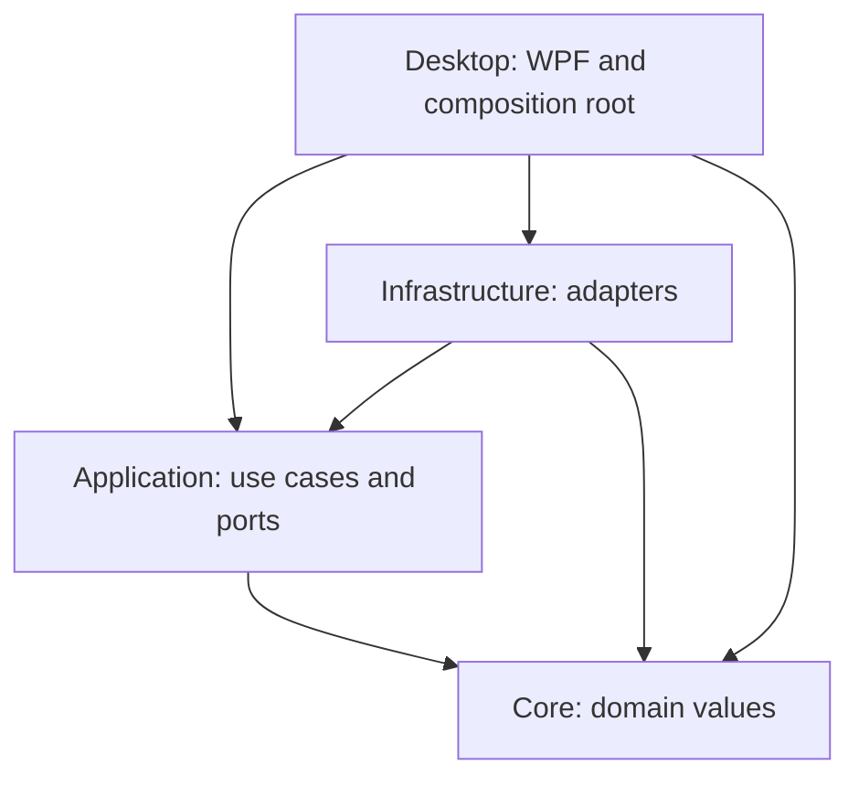

# Architecture

[Explicit Chat handoff](docs/CHAT_PROJECT_HANDOFF.md) adds disposable Application
request tickets bound to the existing workspace lease and work-admission revision.
The admission/retirement lock also protects single-use UI delivery. Desktop owns
draft-only selection, project selection and exact confirmation; fresh handoff Lab
views defer worker startup. Existing planner/validation and explicit reviewed Run
remain the computation boundary. No new catalog, persistence, layer or dependency.

The [research project increment](docs/RESEARCH_PROJECTS.md) adds Application-owned
project contracts and `ResearchLabWorkspace`, an admission/switch controller returning
borrowed project-bound Lab services. Infrastructure implements a bounded versioned
atomic JSON metadata catalog using the existing writer; directories derive only
from the managed profile and generated IDs. Desktop opens an explicit project
picker, then the existing Lab with that identity. One service is admitted at a time;
active/queued requests block retirement, old façades reject execution, and failed
cleanup poisons further admission. Normal view closure retains the App-owned service.
Existing `default-project` artifacts stay in place. The project-selection increment itself does not transfer chat or change numerical
workers or dependency/layer graphs; actual native/independent checks are
tracked separately in Testing.

The 2026-10-19 [text inspection increment](docs/TRUSTED_TEXT_INSPECTION.md) introduces
the first implemented tool/permission ports and a separate native inspection panel.
Application owns the typed descriptor/proposal, sealed preview, opaque single-use
grant and serialized default-deny executor; Infrastructure owns strict text decoding
and retained Windows file/ancestor leases; Desktop owns selection and exact approval.
The App retains executor ownership across view reopenings and cancels on sleep/close.
Intent/outcome logging uses the existing enum-only audit channel. Text and paths never
enter logs, Chat or memory. General task planning, file mutations, memory and model
selection remain unimplemented. Required Windows CI gates, the native window/control
smoke and file/ancestor lease assertions pass on `a999ae4`; physical interaction,
the broader hostile-path matrix and resource qualification remain open.

Status: Phase 2 desktop interactions complete as a development milestone at independent
QA 8.7/10; resource and physical qualification still block release. Configuration, log ports/adapters, instance
activation and WPF shell now exist. Phase 3 adds owned local model inference and
SQLite history and branches, separate temporary sessions, exact local token admission,
and bounded native rich rendering. Phase 4A now implements explicit local Read aloud
and Stop, independently reviewed at 9.0/10. Microphone/recognition remains preserved,
unqualified WIP. The 2026-09-29 ML Lab adds the bounded architecture described below;
general-purpose tools and long-term memory remain intended architecture.

## Optional neural speech output (2026-09-30)

The existing package-free `ISpeechOutput` port now accepts a composite local
provider: the unchanged Windows adapter plus optional Kokoro ONNX CPU speech.
Desktop composes and owns both; closing Chat cancels its operation. Voice selection
routes a closed ID without silent substitution. Preview uses fixed public text and
the same lifecycle as Read aloud, without generating or storing a conversation.

`KokoroNeuralSpeechOutput` owns one hidden Python child in a 1,536 MiB, one-process,
kill-on-close Windows job. The worker admits one bounded stdin command before native
imports, checks memory and pinned local assets, then synthesizes bounded phoneme
chunks. Normal playback is synchronous in memory in that same held process. Speaking
starts after synthesis, immediately before the playback API. Generation has a
separate 90-second deadline; playback retains 30 seconds and cleanup three seconds.
The existing SAPI limits are unchanged. Both providers share one active operation.

The worker runtime is optional and separate from ML/LAYA. No neural package enters
Core, Application or the .NET base dependency set. Phonemizer's temporary DLL copies
use an owned operation directory; checked leaf cleanup follows confirmed child exit.
The brief process-create/job-assignment gap and trusted-native-code boundary remain.
See [voice help and extension rules](docs/MU_NEURAL_VOICES.md) and
[the closed worker protocol](workers/neural_speech/README.md).

## Mu identity and optional LAYA boundary (2026-09-30)

Core owns four closed appearance enums in schema-3 settings. Infrastructure migrates
v1/v2 without writing, preserving prior names (including omitted legacy Pip), scale,
opacity and shortcuts. Desktop's existing vector renderer adds a round particle
preset, five palettes including Galaxy, two faces and three decorations. Settings
uses a static preview; only successful Save updates the companion. Frozen brushes,
system-color rendering and existing animation ownership keep reduced-motion/high-
contrast policy intact. Local matching icon resources are wired explicitly to each
derived native Window, the executable and owned tray Icon. A hover-only connector
keeps the pointer path onto controls continuous at the existing compact bounds.

Application owns `LayaAdvice` and `ILayaDecisionService`; Infrastructure implements
`LocalLayaDecisionService` through the existing Windows job helper and validated
interpreter resolver. This optional App-owned service is independent of chat and the
ML training queue, with one request at a time and cancellation/disposal bounds.
`workers/laya_advisor` admits a closed request before native imports, checks resource
headroom, locks verified assets and invokes the pinned local CPU decision model.
The native Ask Mu view displays advice and excludes stale/truncated/unclear/low-score
hints from the existing planner. No action is created or run by LAYA. The full
checkpoint is installed but actual inference remains unqualified after a safe memory
refusal; synthetic UI and protocol checks qualify only their respective boundaries.

To extend appearance, add validated enum values, renderer handling, selector entries,
migration compatibility and full palette/state/contrast fixtures. To extend local
advice, preserve the closed port, fixed response schema and authority boundary; a
backend/checkpoint update requires new locks, manifests and admitted real-model tests.
See [appearance/LAYA guide](docs/MU_APPEARANCE_LAYA.md) and
[worker contract](workers/laya_advisor/README.md).

## Implemented ML Lab foundation (2026-09-29)

Application owns package-free ML action records, validation, `IMlLabService` and the
local conversational planner. Infrastructure implements an App-scoped FIFO service
and Windows job ownership; Desktop provides the native Lab window and composition.
`workers/ml_lab` separates bounded readers, model registry/preprocessing, evaluation,
persistence/export and the private one-request protocol. See the
[worker extension guide](workers/ml_lab/README.md) and [native UI design](docs/ML_LAB_UI.md).

Each request starts one Python process, assigns its one-process kill-on-close job,
then writes the admitted request. The worker blocks on stdin before loading scientific
packages. The validated base interpreter uses the configured venv identity to avoid
the Windows venv redirector creating a second process. The create-to-job-assignment
gap remains; a job object is not a security sandbox. Defaults are 10,000 rows, 1 GiB
committed memory and two threads; allowed limits are 100,000 rows, 256–4,096 MiB and
1–8 threads. Queue admission is capped at 16, operations at ten minutes, cleanup at
three seconds. Worker CPU/memory telemetry is separate from desktop resource sampling.

Closed actions cover capabilities, browse/inspect, train, list/describe, compare,
predict and export. Dataset references and fingerprint scope are recorded; source
files are never rewritten. Training uses train-only sklearn pipelines, exact source
split indices, explicit seed/configuration and task-specific metrics. Saved models
use bounded `.skops` with version/hash checks and fixed allowed serialization types.
Comparison requires matching dataset fingerprint/selection, features, target, task,
partitions and CV strategy; it does not automatically choose a winner.

The App owns ML lifetime independently of Chat and the Lab window. Closing the view
detaches subscriptions; reopening restores job status and saved work. App exit cancels
and disposes owned work. ML artifacts are explicitly persistent even when Chat is
temporary. No chat message is implicitly promoted into a dataset or experiment.

An optional `IStructuredChatModel` port applies a local JSON schema to the existing
llama.cpp worker. A captured current-selection alias prevents fabricated dataset
paths; choose another source in Data before requesting another file action. The UI
shows the validated action and captured limits before a separate, single-use Run.
The existing 2,048-token context and 256-token reply reserve are unchanged. Learn,
Research and Auto currently guide one proposal, not autonomous search. Native ML
execution and two live proposal fixtures pass; full requested ML Phase 1 remains open.

## Phase 1 implementation decisions

- Core owns immutable validated `CompanionSettings`. Application owns `ISettingsStore`
  and `IEventLog`; Infrastructure implements bounded versioned JSON and content-free
  JSONL logging. No provider/API dependencies are introduced.
- Persistence serializes validated in-memory last-known-good settings into the backup
  before atomic primary replacement. Corrupt primary data is atomically moved to one
  `.invalid` file, without copying unbounded input. Failed/unsupported loads cannot save.
  External valid edits require restart instead of silent overwrite.
- Log records accept enum event/area, operation UUID and optional duration only. Rotation
  bounds files/size; every actual write sweeps all channels by oldest-record age.
  A malformed first record or unterminated tail moves to one `.corrupt` file and surfaces a
  recovery notice. Retention may discard a whole file with newer records; it is a bound,
  not a promise to retain every recent event. No cleanup happens while the app is closed.
- Composition lives in Desktop. Runtime lifetime owns a cancellation source and serial
  save gate; async close drains work with a deadline. Postcommit diagnostic cancellation
  reports settings saved with a logging warning, never falsely reports rollback.
- Settings capture the requested preferences and native options when Save starts.
  Shutdown marks the settings window before disposing desktop integration, preventing
  a delayed save continuation from applying appearance, registering shortcuts, changing
  startup or re-enabling controls. A completed file commit remains committed even when
  shutdown suppresses the later UI effects.
- Single instance uses an exclusive profile/session file handle, released even on
  process death, plus a same-user named pipe carrying only a one-byte activation and
  acknowledgment. No commands, paths or free-form payload cross that IPC boundary.
- `--data-dir` selects an explicit absolute local test/development profile; UNC/device
  paths are rejected after normalization. Smoke modes exercise real composed services.
- MSTest is a pinned test-only dependency. The exact owning-layer allowlist includes
  SQLite and System.Speech in Infrastructure, and native rich rendering in Desktop;
  Core and Application remain package-free.
  The dependency-free repository checks remain alongside standard test discovery/TRX.

## Technology decisions

Use C# on .NET 10 LTS, WPF, and narrowly wrapped Win32 calls. The inspected machine
has SDK 10.0.401 and WindowsDesktop runtime 10.0.12. Microsoft lists .NET 10 as active
LTS through November 2028 ([support policy](https://dotnet.microsoft.com/en-us/platform/support/policy)).
The first supported release target is Windows 11 x64; ARM64 is a later build/test
matrix extension. Target framework `net10.0-windows` is not a promise to support
every Windows version it can compile for.

WPF supports nonrectangular transparent windows with `AllowsTransparency` and
`WindowStyle=None` ([API documentation](https://learn.microsoft.com/en-us/dotnet/api/system.windows.window.allowstransparency?view=windowsdesktop-10.0)).
It also provides vector drawing, animation, binding, accessibility and Win32 interop.
Choose it over WinUI 3 for this initial overlay-focused product: mature window control
and fewer deployment dependencies outweigh adopting the newest visual framework.
This is an engineering tradeoff, not a measured performance superiority claim.
WinUI remains viable if a later prototype establishes a material accessibility or
rendering advantage. Avalonia adds a cross-platform objective not presently needed;
Electron/Tauri introduce a second UI runtime without solving the overlay's native
integration. WPF styling will use shared design tokens and native accessible controls.

Use a modular monolith initially, not microservices. No C++ is needed before profiling
identifies a hot path; a native library then exposes a versioned C ABI with explicit
ownership and SafeHandle wrappers, and is built with CMake plus sanitizer tests.
The user selected pretrained local inference after considering from-scratch training.
A pinned llama.cpp C++ worker supplies tensor inference outside the WPF UI; there is
no Python or training dependency in this path. The earlier Python experiment is
paused. See [the local AI decision](docs/LOCAL_AI.md).

Phase 3 uses SQLite via Microsoft.Data.Sqlite with explicit SQL and a closed versioned
schema. Versioned JSON remains appropriate for nonsecret preferences and manifests.
Pinned packages are introduced only in their owning phase, with provenance, license,
advisory review and lock files. See [dependency inventory](docs/DEPENDENCIES.md).

## Dependency structure

Core has no framework, filesystem, network, UI or database references. Application
owns ports and workflows. Infrastructure implements ports, including providers,
storage, voice, Windows integration, deterministic math and approved tool handlers.
Desktop binds view models, marshals updates onto its dispatcher and constructs the
services. Feature namespaces (Conversation, Memory, Tools, Voice, Avatar, Science,
Security, Storage) belong within these layers; split projects only when independent
deployment or dependency isolation warrants it. The test executable checks the
initial project graph. No service locator or global mutable permission state.

## Conversation, providers and logical agents

The flow is UI intent → primary assistant use case → bounded conversation engine →
selected provider → typed events → UI. The planner optionally turns a complex intent
into a versioned task plan (steps, dependencies, preconditions, status and cancellation).
The executor authorizes each tool operation separately. A model cannot approve its
own proposal. A runtime quality evaluator can check citations and call deterministic
validators; it is distinct from the mandatory independent **development QA agent**.

The implemented `IChatModel` boundary accepts bounded role/text messages and emits
typed text deltas and completion; failures use fixed application errors. Conversation
snapshots separately own stable conversation/turn IDs, branch parents and terminal
outcomes. No provider SDK types or raw chain-of-thought enter UI/domain contracts.
Future multimodal/tool adapters may add typed content parts, capability discovery,
turn sequencing and usage events. Those extensions are not capabilities of the
current local text worker.

The user selected a pretrained model running locally without an API key. Phase 3
uses an owned llama.cpp CPU worker, bounded authenticated loopback streaming,
separate temporary and SQLite-backed saved conversations, title/search/delete,
edit/regenerate branches and native rich rendering. There is no cloud fallback.
The provider-independent port is an
architecture boundary, not a hosted-service requirement. Downloaded model weights
come from their original publisher; the user controls local inference and data.
This supersedes both the provider-first and briefly considered from-scratch plans.

One active turn owns a cancellation source and window lifetime guard. The adapter
also admits only one concurrent stream; closing chat cancels work and unloads its
worker. Saved prompts commit before inference, followed by a completed, interrupted
or failed terminal update. An abandoned in-progress turn reopens as interrupted.
Stream fragments not yet finalized may be lost on a crash. Editing or regenerating
creates a new branch, preserving previous turns; partial replies remain visible but
are excluded from model context. A save failure offers explicit retry or temporary
continuation. Context first obeys message/UTF8 bounds, then the owned worker's actual
chat template and tokenizer. Oldest complete pairs are removed until the prompt fits
1,792 tokens, leaving 256 output tokens in the 2,048-token context. A latest prompt
that cannot fit fails before generation. Bounded SSE parsing, idle and absolute turn
deadlines include this admission work. Future stream batching and summarization must
preserve cancellation and may not promote content to approved memory.

Chat uses a native WPF input/history shell and `FlowDocument` response display.
Markdig parses a fixed Markdown subset; application code creates only approved WPF
nodes. Code highlighting uses a bounded scanner. WpfMath renders an allowlisted
LaTeX subset into frozen local geometry, which displays notation without verifying
its mathematics. Every message has a literal role label and a separately parsed
body, preventing an unfinished fence from changing the next message. Shared limits
cover 48 KiB of input, 2,000 AST nodes, nesting depth 16 and 32 math expressions;
individual formulas allow at most 512 characters and 64 approved commands. Unsupported
syntax is literal. HTML, links and remote image markup have no executable or navigation
behavior; there is no web runtime or external resource loader. Streaming stays plain
text; completed display can switch between formatted and plain text. The formatted
view keeps the newest bounded messages and discloses omissions. Search, stop, retry,
titles, edit/resubmit, regenerate and branch navigation have dedicated UI/storage fixtures.

## Avatar and desktop integration

Implemented `IAvatarRenderer` accepts semantic state and animation/high-contrast policy,
without conversation text or permissions. The default WPF vector control owns its
timelines and facial geometry; the host owns input, scale and placement. Eight states
are implemented: idle, listening, thinking, working, speaking, notifying, sleeping and
error. Scoped activity ownership prevents late completion from clearing newer work.
Sleep invalidates all visual leases; otherwise priority is error, listening, speaking,
working, thinking, notifying, idle. Future audio/conversation callers must cancel work
before entering sleep and derive speaking from actual playback. Current expression
previews are visibly labeled, last four seconds, and start no microphone or provider.
Idle uses one dispatcher timer: wait ten seconds, close the eyes for 120 milliseconds,
then reopen. Existing eye transforms change only at these transitions; idle owns no
WPF animation clocks. Active expressions use at most two capped 20-fps controllable
clocks, explicitly stopped, removed and detached on a state or motion-policy change.
Hide, sleep, reduced motion and unload stop the timer too; window close disposes the
renderer. The harness distinguishes enabled motion policy from completed timed blinks.
The ten-second cadence was selected before the next controlled run after the six-second
version measured 1.093335% visible-idle CPU against the unchanged exclusive 1% budget.
The closure duration and measurement method remain unchanged; earlier failures are retained.

Asset manifests declare schema version, ID, attribution/license, layers (body, face,
eyes, hair, clothing, accessories), palette, anchors, animation clips, frame bounds and
fallback states. Validate size, frame count, paths and decoded image dimensions. Never
load user XAML or scripts. A future 3D adapter consumes the same state model but will
have its own rendering surface/capability declaration; no 3D engine dependency now.

Native companion HWND: borderless/transparent, nonactivating when appropriate,
optional topmost and explicitly enabled click-through. Settings UI stays interactive.
Dragging uses device-independent coordinates converted at the monitor boundary;
persist monitor identity plus relative position, re-clamp on display/DPI/work-area
changes, including negative coordinates and disconnected screens. Edge snapping uses
work areas, not total monitor bounds. The per-monitor-v2 manifest is present, but
actual mixed-DPI behavior remains a pending Phase 2 validation matrix. Placement stores
device identity and fractions of available travel `(position-origin)/(work-size)`;
an oversized axis anchors to its work-area origin. Restore first moves to the selected
monitor, lets WPF process DPI/layout, then uses the actual new HWND size for placement.
A separate bounded atomic `placement.json` prevents move autosave from overwriting
explicit preference edits. Moves capture a normal-state snapshot before debouncing,
so immediate Hide/minimize/Exit can still flush that move. Unsupported/oversized files
remain untouched. Native behavior follows Microsoft's [DPI notification contract](https://learn.microsoft.com/en-us/windows/win32/hidpi/wm-dpichanged).
Initial placement loading disables companion input before its first await and restores
the prior enabled state only while the window/session remain alive. Native restoration
requires a visible normal window at both stages; closure, shutdown, hiding or minimizing
cannot trigger a stale final restore. Tray actions are installed after initialization.
Ctrl+Shift+M and Next display cycle a deterministic top/left/device-ID monitor order,
preserve relative placement and use the same two-step DPI restore. One available
display produces a visible no-op status; physical cross-display validation is pending.

A successfully registered, user-changeable hotkey is required before hiding or
enabling click-through. The tray also offers recovery, but requested NotifyIcon
visibility is not proof that Windows created the icon and cannot authorize those
actions by itself. Handle shortcut conflicts visibly and retain a prior working
registration. No focus stealing on notifications.
Single-instance activation uses a current-user named pipe and a restricted message
schema. Startup registration is opt-in and reversible through an explicit settings save;
it writes one quoted, argument-free executable command under HKCU Run. The adapter is
never invoked automatically from preferences load. Tray uses the framework's NotifyIcon
with deterministic icon/menu disposal; no package is added. Click-through sets
WS_EX_TRANSPARENT only on the owned layered HWND, consistent with Microsoft's
[layered-window hit testing](https://learn.microsoft.com/en-us/windows/win32/winmsg/window-features).
Recovery clears it before showing the window. Hidden/minimized/disabled/sleep states
stop animation. General occlusion detection is not implemented; an occluded visible
window may continue its capped animation. It remains a measured optimization follow-up.
Short speech bubbles are length/time bounded and dismissible; long content opens the
panel only on user action. Screen readers receive text state labels, not color alone.

## Voice and personality

The implemented Phase 4A slice reads only an explicitly selected completed reply
after Read aloud. `ISpeechOutput` is an Application contract; Infrastructure uses
pinned System.Speech 10.0.12 and eligible enabled Microsoft Windows voices. Voice and
rate choices are session-only, with rates -5 through +5. Reply completion, rich
rendering and history changes never automatically start speech. Chat keeps its full
text; read-aloud input is clipped to 2,000 UTF-16 characters without splitting a
surrogate pair, and the limit is disclosed.

Each enumeration, speech or inaudible probe uses one owned child of the current
desktop executable in its private `--speech-worker` mode. A background STA owns
native speech objects. Bounded, length-prefixed JSON over redirected standard input
and output carries a single operation identity; no text enters command-line
arguments, logs or audio files. The supervisor validates ordering and exact terminal
events, permits one operation without a queue, and bounds the operation at 30 seconds.
Stop, timeout and disposal terminate only the held child identity and its private
kill-on-close job, with a three-second cleanup acknowledgment bound. Content is sent
only after job assignment; the launch-to-assignment gap is mitigated by stdin EOF
and the worker deadline, not eliminated by suspended startup.

The worker selects the chosen installed voice again before synthesis and passes
plain text to `SpeakAsync`, never SSML or an external lexicon. Default-output
`SpeechSynthesizer.SpeakStarted` produces the owned Speaking event. This is an engine
event, not a physical speaker clock or proof that sound was heard. Cleanup releases
that operation's state; queued old events cannot resume another operation. New send,
new chat, history navigation, edit/branch, close and companion sleep cancel output.
Failures preserve readable text. The separate memory diagnostic caps PCM/WAVE storage
at 4 MiB and returns format/size/duration/hash metadata only; memory synthesis does
not produce the application's Speaking event or establish audible playback.

The remaining full voice design is capture → bounded PCM frames → local VAD → STT →
conversation → TTS → playback. Microphone capture, push-to-talk, recognition, explicit
input/output endpoint selection and optional activation remain future work. Activation
requires a persistent visible indicator. Half-duplex capture suppression and a
calibrated playback tail must prevent an automatic feedback loop; echo cancellation
or full duplex requires measured device tests. Physical device removal, permission,
output and heard-stop checks remain qualification work. The existing implementation
uses the default output device and does not qualify this wider voice loop.

Personality is a separate validated configuration: name, description, tone, verbosity,
humor, curiosity, formality, initiative, expression behavior and preferred address.
The prompt composer applies immutable application rules and explicitly scoped data
alongside personality. This is UX composition, not a security boundary: the permission
service enforces policy independently even if the prompt or model fails.

## Memory and storage

Categories: conversation context, transient working set, explicit long-term memories,
project memories and preferences. `IMemoryProvider` exposes scope-aware read/write/
edit/delete operations and provenance; approval is a UI-issued record, never a model
boolean. Auto-suggestions remain pending and expire until explicitly accepted.
Retrieval uses conversation/project scope and enabled-category filters before matching.
Start with SQLite full-text search; embeddings are optional later and carry provider,
model and dimension metadata, consent and deletion lifecycle.

Implemented conversation storage is `conversations.db` under the selected local
profile, with `conversations` and `turns` tables, a fixed application ID and SQLite
`user_version=1`. Turns store ancestry, text and outcome; transactions, foreign keys,
parameterized SQL and explicit indexes protect consistent branch changes. The store
bounds 100 conversations, 256 turns per conversation, four million stored text
characters and a 64 MiB database. Search is bounded, ordinal case-insensitive literal
matching, not full-text indexing. A serialized gate runs SQLite work on a background
task: Microsoft.Data.Sqlite's asynchronous methods alone do not move synchronous
database work off the dispatcher
([SQLite async limitations](https://learn.microsoft.com/en-us/dotnet/standard/data/sqlite/async)).

Existing data is inspected read-only before write access; unknown schema versions,
corruption, oversized files and reparse-point paths fail visibly. New databases use
SQLite's default rollback journaling; the store does not enable WAL. Hot-journal
recovery first validates a bounded isolated copy and rechecks source identities before
admitting recovery writes. A hot recovery mixed with WAL/SHM files is refused. This
recovery path is not a general import, backup/export or schema migration service.
Settings remain atomic JSON with a last-known-good backup, alongside bounded
content-free logs under `%LOCALAPPDATA%/DesktopCompanion/` or the explicit test profile.

Later memory/productivity phases may add `schema_migrations`, separate messages,
memory entries/scopes/approvals, projects, notes, tasks, reminders and tool audit.
Versioned transactional migrations, coherent backups including any SQLite sidecars,
read-only recovery/export and advanced indexes remain future storage work. Stable IDs,
UTC instants and explicit user timezones will govern scheduled data. No migration may
silently replace an unknown or corrupt sole copy.

Temporary conversations use an in-memory repository and exclude persisted chat,
summaries, memories, embeddings, attachment caches and content-bearing logs. Disable
general conversation tools in temporary mode until the user switches to a normal
conversation; no ambiguous private-session notes. The separately opened ML Lab has
its own persistent-project disclosure and explicit execution controls. Remote providers may retain submitted content; private
mode promises local app persistence behavior, not remote erasure or immunity to OS
paging/crash dumps. Deletion removes application references and retrieval indexes;
WAL/backups/SSDs require separate retention handling and are not guaranteed forensic erase.

## Tools, science and extensions

See [contracts](docs/CONTRACTS.md) and [threat model](SECURITY.md). All tool proposals
pass schema, permission, scope, resource identity and cancellation checks. SAFE means
explicitly allowlisted low risk, not unrestricted OS access. Unknown tool/risk values
deny. The application owns confirmation UI and grants. Audit failure blocks
consequential actions. No default arbitrary shell, email, calendar or install tool.

Initial productivity implementations: deterministic calculator, notes, timers/reminders
and bounded inspection of user-selected plain text. Each uses the task representation.
Add file mutations only after operation-bound confirmation and rollback/recovery design.
Future email/calendar/Git integrations each receive service-specific permissions and
idempotency rules, not inherited blanket authorization.

Science services parse an allowlisted expression grammar, never language `eval`.
Return results with method, units, domain checks and precision, distinguishing verified
computation from model explanation. Unit conversion uses canonical dimensions plus
explicit affine offsets (temperature); uncertainty propagation includes covariance.
Numerical analysis must test limiting cases, nonfinite values and independent oracles.
Plots accept data/specifications with bounds, not executable model scripts.

Third-party plugin code is not loaded into the host. Future workers use versioned,
length-prefixed JSON messages on current-user ACL-restricted named pipes, bounded
payloads/timeouts, request IDs, explicit cancellation and negotiated protocol versions.
Reject unknown versions. Job objects limit resources/lifetime; **a process or job object
alone is not a security sandbox**. Untrusted executable plugins remain unavailable
until AppContainer/restricted-token isolation and capability brokering are verified.
Workers never receive provider secrets, generic shell access or broad host proxies.

## Reliability, packaging and performance

Async I/O belongs off the UI thread; all observable UI changes go through the dispatcher.
Bound queues, tokens, files, messages, image decoding and retries. Timeouts are
configurable within safe maxima. Retry only idempotent network reads/requests before
visible partial output; respect rate limits and cancellation. Graceful shutdown cancels
turns/audio and drains storage with a deadline; next start marks unfinished work.

Structured event families: application, diagnostics, errors, tool audit. Record stable
error codes, operation IDs, duration and sanitized metadata; omit prompts, transcripts,
file contents, credentials, headers and URL query strings by default. Local rotation,
retention limits and explicit redacted diagnostic export; no silent telemetry upload.
Phase 11 verifies redaction and privacy paths, not just documentation.

Performance targets: cold launch p95 under 2 s on declared reference
hardware, hidden/idle host CPU under 1% of one logical processor averaged 60 s,
idle private bytes under 150,000,000 bytes (decimal MB)
excluding a documented on-demand chat process budget, visible animation p95 frame under
33 ms, cancel feedback under 250 ms. Capture baseline environment and trace files in
Phase 2/12; change targets only with evidence and a recorded decision. Native rich
rendering and on-demand model inference require measured workload budgets; earlier
avatar-only measurements do not qualify the current chat workload.

Before the resumed controlled measurement on 2026-09-22, independent QA and the
implementation agent resolved the previously ambiguous CPU/MB denominators
conservatively: CPU is `100 * process CPU seconds / elapsed seconds`, without dividing
by processor count, and memory uses decimal bytes. Machine-normalized CPU and MiB
remain supplementary reporting. This keeps the budget comparable across core counts;
it is not permission to select a friendlier denominator after seeing measurements.

The performance harness has an explicit observer option: `threads` remains the default
and includes two thread snapshots inside each interval; `process` omits only those
snapshots. Both include one-second native process-counter reads and all enabled
measurement overhead. The [predeclared observer comparison](docs/qa/PHASE_2_OBSERVER_PROTOCOL.md)
freezes the build, supervisor and protocol before four sequential A/B/B/A runs. Its
limited acceptance rule requires both process-only runs to pass every fixed-budget
interval; it neither changes production rendering nor replaces physical display/input
validation. Results and limits belong in the independent QA report. The later final-build
confirmation failed: one process-only run exceeded visible and reduced-motion CPU
limits, while the second passed. The explicit
[post-result sequencing decision](docs/qa/PHASE_2_RESOURCE_SEQUENCE.md) retains that
failure and the unchanged budget as a mandatory Phase 12 release gate; it permits
conversation development under the user's weighted QA requirement without claiming
resource compliance.

Phase 12 produces a signed per-user installer, dependency/license inventory, update
manifest/signature validation, staged downloads, user-controlled restart, rollback and
uninstall/data-retention choices. No self-updater executes unsigned remote code. MSIX
versus a signed bootstrapper is an explicit Phase 12 compatibility spike for tray,
startup and overlay behaviors. Builds remain runnable before packaging is finalized.
